# Doctor Tracker

> A secure admin portal for managing doctors, their patients, and the clinical numbers that matter.

## Description

**Doctor Tracker** gives hospital administrators one place to run their doctor roster and patient caseload. Signed-in staff can register doctors, open any doctor to see and manage their patients, and work through thousands of patient records with instant search, date and condition filters, and pagination. A live analytics dashboard turns the data into decisions: admission trends, critical-case volume, patients per doctor, specialization load and demographics. The app is a **Next.js** client talking to a standalone **Express + MongoDB** REST API. Every list query is served by a purpose-built index, so it stays fast as the data grows.


## Live links

| What | Link |
| --- | --- |
| 🌐 **Live website** (frontend, Vercel) | **https://doctor-tracker-frontend-two.vercel.app** |
| ⚙️ **Live API** (backend, Render) | **https://doctor-tracker-api-4x90.onrender.com** · health check: [`/api/health`](https://doctor-tracker-api-4x90.onrender.com/api/health) |
| 📦 **Frontend repository** | https://github.com/saiful199324/doctor-tracker-frontend |
| 📦 **Backend repository** | https://github.com/saiful199324/doctor-tracker-backend |
| 🗂️ **This repository** | Combined development workspace (`client/` + `server/`) |

**Demo accounts**

| Role | Email | Password | Can do |
| --- | --- | --- | --- |
| Admin | `admin@doctortracker.dev` | `Admin@12345` | Everything, including deletes |
| Staff | `staff@doctortracker.dev` | `Staff@12345` | View, create and edit; no deletes |

---

## Try the live app

1. Open **https://doctor-tracker-frontend-two.vercel.app**. You'll be taken to the sign-in page.
2. Click **Fill demo credentials**, then **Sign in**.
3. Things to try:
   - **Dashboard:** switch **7D / 30D / 90D / 12M**, and click a bar in "Patients per doctor" to open that doctor.
   - **Doctors:** search (`card`), open **Filters** (specialization, hospital, joined date), **Add doctor**, and use the pages.
   - **A doctor's page:** **Add patient** under that doctor, edit a patient, remove one.
   - **Patients:** condition chips, search, filters (doctor, gender, age group, admission dates), edit and delete.
   - Sign in as **staff** to check that delete buttons are hidden. Toggle 🌙 dark mode, or shrink the window to see the mobile layout.

> ⏱️ The API runs on Render's free plan. Outside 08:00–23:00 Bangladesh time it may be asleep, so the **first sign-in can take up to a minute** while it wakes up. After that it's fast. All data is shared demo data, so feel free to add, edit and delete.

---

## Run locally

You need **[Node.js 20+](https://nodejs.org)** and **MongoDB**: either **[Docker Desktop](https://www.docker.com/products/docker-desktop/)**, which the steps use, or a free [MongoDB Atlas](https://www.mongodb.com/atlas) connection string. The commands work in PowerShell, Git Bash, macOS and Linux terminals.

### Option A: the two separate repositories (recommended)

Use two terminals, one for the backend and one for the frontend.

**Terminal 1: backend API** → http://localhost:4000

```bash
git clone https://github.com/saiful199324/doctor-tracker-backend.git
cd doctor-tracker-backend
npm install
cp .env.example .env          # defaults work as-is for local development
docker compose up -d          # starts MongoDB on 127.0.0.1:27017
npm run seed                  # demo users, 60 doctors, 3,000 patients + indexes
npm run dev                   # API at http://localhost:4000
```

**Terminal 2: frontend website** → http://localhost:3000

```bash
git clone https://github.com/saiful199324/doctor-tracker-frontend.git
cd doctor-tracker-frontend
npm install
cp .env.example .env.local    # defaults already point to http://localhost:4000
npm run dev                   # website at http://localhost:3000
```

Open **http://localhost:3000** and sign in with `admin@doctortracker.dev` / `Admin@12345`.

### Option B: this combined workspace (one terminal)

```bash
git clone https://github.com/saiful199324/doctor-tracker.git
cd doctor-tracker
npm run setup                 # installs root, server/ and client/ dependencies
cp server/.env.example server/.env
cp client/.env.example client/.env.local
npm run db:up                 # MongoDB via Docker
npm run seed                  # demo data + indexes
npm run dev                   # API :4000 and website :3000 together
```

### Running it again later (after a restart)

Setup is a one-time job. Next time, for example after restarting your computer, you only need two steps. The **live website** needs nothing: it keeps running on Vercel and Render while your computer is off.

1. **Start Docker Desktop** and wait until it shows **Engine running**. The MongoDB container starts by itself with Docker (`restart: unless-stopped`), and your data is kept.
2. **Start the app** in the project folder (in VS Code: **Terminal → New Terminal**):

   | Setup you used | Run |
   | --- | --- |
   | Option A: two repositories | `npm run dev` in `doctor-tracker-backend`, then `npm run dev` in `doctor-tracker-frontend` (two terminals) |
   | Option B: this workspace | `npm run dev` (starts both) |

Wait for `API listening on http://localhost:4000` and `Ready`, then open **http://localhost:3000**. Press <kbd>Ctrl</kbd>+<kbd>C</kbd> to stop.

> If MongoDB doesn't start with Docker, run `docker compose up -d` in the backend (or `npm run db:up` in this workspace) once. To get fresh demo data, run `npm run seed`. Production mode instead of development: `npm run build`, then `npm start`.

### Useful commands

| Command | Where | What it does |
| --- | --- | --- |
| `npm run dev` | either app | Development server with hot reload |
| `npm run build && npm start` | either app | Production build and server |
| `npm run seed` | backend | **Resets** doctors and patients to fresh demo data (and the two users) |
| `npm run seed -- --patients=100000` | backend | Large dataset for performance testing |
| `npm run db:indexes` | backend | Builds missing indexes and drops obsolete ones |
| `npm run lint` / `npm run typecheck` | frontend / both | Code checks |
| `docker compose down` | backend | Stops MongoDB (data is kept in a Docker volume) |

### Troubleshooting

| Problem | Fix |
| --- | --- |
| **"Invalid environment configuration"** when starting the API | You skipped `cp .env.example .env`. The message names the missing variable. |
| **Sign-in says "Invalid email or password"** | Run `npm run seed` in the backend to create the demo users. |
| **Signing in sends you back to the login page** | `JWT_SECRET` must be **identical** in the backend `.env` and the frontend `.env.local`. The example files already match. |
| **Pages load but show "The API is unreachable"** | Start the backend (`npm run dev`) and check that the frontend's `API_URL` is `http://localhost:4000`. |
| **"MongoServerSelectionError" / ECONNREFUSED 27017** | Start Docker Desktop, then `docker compose up -d`. Or put an Atlas connection string in `MONGODB_URI`. |
| **"Port 4000 is unavailable" or "port 3000 is in use"** | Another app uses the port. Change `PORT` in the backend `.env` (and `API_URL` in the frontend to match), or run the frontend with `npx next dev -p 3001`. |
| **`docker compose up` says the name "doctor-tracker-mongo" is in use** | A MongoDB container from the other setup option already exists. Start it with `docker start doctor-tracker-mongo` instead. |
| **`cp` isn't recognised** (old Windows `cmd`) | Use `copy .env.example .env`, or PowerShell or Git Bash. |

---

## Table of contents

1. [Live links](#live-links) · [Try the live app](#try-the-live-app) · [Run locally](#run-locally)
2. [Features](#features)
3. [Tech stack](#tech-stack)
4. [Setup guide (detailed)](#setup-guide-detailed)
5. [System architecture](#system-architecture)
6. [Technical decisions](#technical-decisions)
7. [Performance & optimization](#performance--optimization)
8. [API reference](#api-reference)
9. [Project structure](#project-structure)
10. [Visual evidence](#visual-evidence)
11. [Scalability considerations](#scalability-considerations)

---

## Features

| Area | What you can do |
| --- | --- |
| **Authentication** | Email/password sign-in, JWT in an `httpOnly` cookie, route guard in Next.js middleware, login rate-limiting, and role-based authorization (`admin` / `staff`). |
| **Doctors** | Create, edit and delete doctors (name, specialization, hospital, phone, email). Search, filter by specialization / hospital / join date, sort, and paginate. Each row shows a live patient count. |
| **Doctor detail** | Profile, caseload breakdown by condition, and the doctor's own paginated, searchable, filterable patient list. Add patients under the doctor and remove them. |
| **Patients** | Dedicated page listing every patient. Edit or delete records. Search by name/phone/email/diagnosis. Filter by condition, doctor, gender, age group and admission date range. |
| **Dashboard** | KPI cards with period-over-period trend, admissions timeline (7D / 30D / 90D / 12M), condition donut, patients-per-doctor ranking (click to drill in), patients and doctors by specialization, age and gender demographics, and recently added patients. |
| **UX** | Responsive from 320 px phones to wide desktops (sidebar on desktop, drawer on mobile, tables become cards below 1280 px), dark mode with no flash on load, skeleton loaders, empty and error states, branded 404 page, toasts, accessible dialogs, and shareable URL-based filters. Passes axe-core WCAG 2 AA checks in both themes. Keyboard-friendly (skip link, visible focus), and respects "reduce motion". |

**Permissions:** both roles can view, create and edit. Only `admin` can delete doctors and patients. The API enforces this, and the UI hides delete buttons for staff.

## Tech stack

| Layer | Choice |
| --- | --- |
| Client | Next.js 15 (App Router), React 19, TypeScript, Tailwind CSS v4 |
| Server state | TanStack Query v5 |
| Forms & validation | React Hook Form + Zod (the same rules on client and server) |
| Charts | Recharts 3 |
| API | Node.js 20, Express 4, TypeScript |
| Database | MongoDB 7 with Mongoose 9 |
| Security | JWT (`httpOnly`, `SameSite=Lax` cookie), bcrypt, Helmet, express-rate-limit, Zod input whitelisting |

---

## Setup guide (detailed)

The [Run locally](#run-locally) section above is the quick path. This section explains every setting.

### Prerequisites

- **Node.js 20+** and npm
- **MongoDB 6+**: either Docker (a `docker-compose.yml` is included) or a local/Atlas instance

### 1. Clone and install

```bash
git clone https://github.com/saiful199324/doctor-tracker.git
cd doctor-tracker
npm run setup            # installs root, server/ and client/ dependencies
```

### 2. Configure environment

Each app ships an `.env.example`. Copy them:

```bash
cp server/.env.example server/.env
cp client/.env.example client/.env.local
```

| File | Variable | Purpose |
| --- | --- | --- |
| `server/.env` | `PORT` | API port (default `4000`) |
| | `MONGODB_URI` | Mongo connection string |
| | `JWT_SECRET` | ≥ 32 random characters (`openssl rand -hex 32`) |
| | `JWT_EXPIRES_IN` | Session length, e.g. `1d` |
| | `CLIENT_ORIGIN` | Allowed browser origin(s) for CORS |
| | `SEED_*` | Credentials created by the seed script |
| `client/.env.local` | `API_URL` | Where Next.js proxies `/api/*` (default `http://localhost:4000`) |
| | `JWT_SECRET` | **Same value as in `server/.env`.** The route guard uses it to verify session signatures |

The example values work as-is for local development (both files ship the same placeholder secret). For any shared or deployed environment, generate one real secret and put it in **both** files. The server validates its environment on boot and exits with a clear message if anything is missing.

### 3. Start MongoDB

```bash
npm run db:up            # docker compose up -d  → mongodb://127.0.0.1:27017
```

Using your own MongoDB instead? Point `MONGODB_URI` at it and skip this step.

### 4. Seed demo data

```bash
npm run seed             # 2 users, 60 doctors, 3,000 patients spread over ~14 months
# larger dataset for performance testing:
npm --prefix server run seed -- --doctors=200 --patients=100000
```

### 5. Run

```bash
npm run dev              # API on :4000 and web on :3000 together
```

Open **http://localhost:3000** and sign in.

Production build: `npm run build && npm start`.

### Deployment

| Part | Host | Repository |
| --- | --- | --- |
| Frontend (Next.js) | **Vercel** (Hobby), function region `sin1` | [doctor-tracker-frontend](https://github.com/saiful199324/doctor-tracker-frontend) |
| Backend (Express API) | **Render** (free web service, Singapore) | [doctor-tracker-backend](https://github.com/saiful199324/doctor-tracker-backend) |
| Database | **MongoDB Atlas** (free M0, AWS Singapore) | |

```
Browser ──HTTPS──▶ Vercel (Next.js)
                     ├─ pages (middleware verifies the session JWT)
                     └─ /api/* proxy route ──HTTPS + x-client-ip / x-proxy-secret──▶ Render: Express API ──▶ MongoDB Atlas
```

- **Same-origin proxy.** The browser only calls the website's own `/api/*`. A route handler (`client/src/app/api/[...path]/route.ts`) forwards each request to the Render API, so the session cookie stays first-party on the Vercel domain. That works in every browser, with no CORS and no `SameSite=None`.
- **Shared secrets.** `JWT_SECRET` is identical on both hosts, because the frontend middleware verifies the same token the API issues. `PROXY_SECRET` is also identical on both: the proxy uses it to forward the visitor's real IP to the API's login rate limiter, and the API ignores a forwarded IP without it. Direct API callers are identified by Cloudflare's `cf-connecting-ip` (`CLIENT_IP_HEADER`). Both paths were verified in the production logs.
- **Auto-deploy.** Vercel deploys the frontend repository and Render deploys the backend repository on every push to `main`. This workspace publishes `client/` and `server/` to them with `git subtree push`.
- **Database.** A dedicated user with `readWrite` on `doctor_tracker` only. The data was loaded with `npm run seed`, and indexes are managed with `npm run db:indexes`.
- **Keep-awake.** The backend repository's GitHub Actions job pings `/api/health` every 10 minutes from 08:00 to 23:00 Bangladesh time. It doesn't run around the clock, because Render's free instance hours are shared across the workspace.

### Run a live demo from your own machine

```bash
npm run live             # MongoDB up → production build → API + web + ngrok tunnel
```

This needs Docker running and [ngrok](https://ngrok.com/download) installed with an authtoken (`ngrok config add-authtoken <token>`). The free plan gives each account one permanent `*.ngrok-free.dev` address, which ngrok uses automatically. On the first visit, ngrok shows a one-time notice; click **Visit Site** to continue. Stop everything with <kbd>Ctrl</kbd>+<kbd>C</kbd>.

> **Windows note:** port 5000 is often reserved by Hyper-V, which is why the API defaults to 4000. If a port is taken, the server says so and exits.

## System architecture

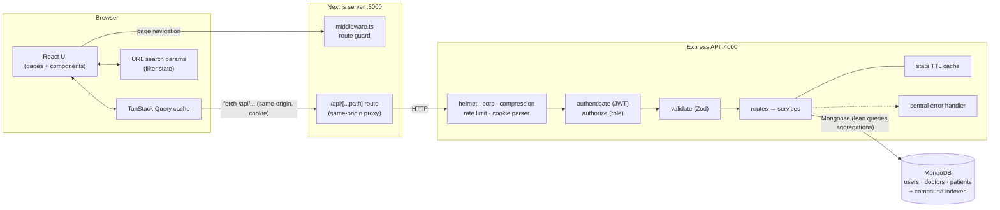

### Request lifecycle

1. **Navigation.** `client/src/middleware.ts` runs on every page request and **cryptographically verifies** the `dt_token` JWT with `jose`: HS256 signature with the shared secret, pinned algorithm, and expiry. A missing, forged, tampered or expired token redirects to `/login?next=…` and deletes the bad cookie, before any private UI renders. It fails closed: without a configured secret, everyone is treated as signed out. Signed-in users visiting `/login` are sent to the dashboard. The API runs the same verification on every request, so pages and data are protected independently.
2. **Data fetching.** Client components call typed hooks (`useDoctors`, `usePatients`, `useOverview`, …). TanStack Query handles caching, de-duplication, request cancellation via `AbortSignal`, and `keepPreviousData` for pagination.
3. **Proxy.** The browser only ever calls its own origin (`/api/...`). The route handler `client/src/app/api/[...path]/route.ts` forwards each request to the Express API (`API_URL`), with the visitor's IP and a shared secret, and returns the response unchanged. The auth cookie therefore stays first-party, and no CORS preflights are needed.
4. **API pipeline.** Security middleware → `authenticate` verifies the JWT → `authorize('admin')` on destructive routes → `validate()` parses `params`, `query` and `body` with Zod (coercing types and stripping unknown keys) → controller → service → MongoDB.
5. **Errors.** Everything funnels into one error handler that returns a consistent shape: `{ success: false, message, errors?: { field: [msg] } }`. Forms map `errors` onto the matching inputs.
6. **Writes.** Mutations invalidate the relevant query keys (doctors, patients, stats), so every open view refreshes. The server also clears its short-lived dashboard cache.

### Data model

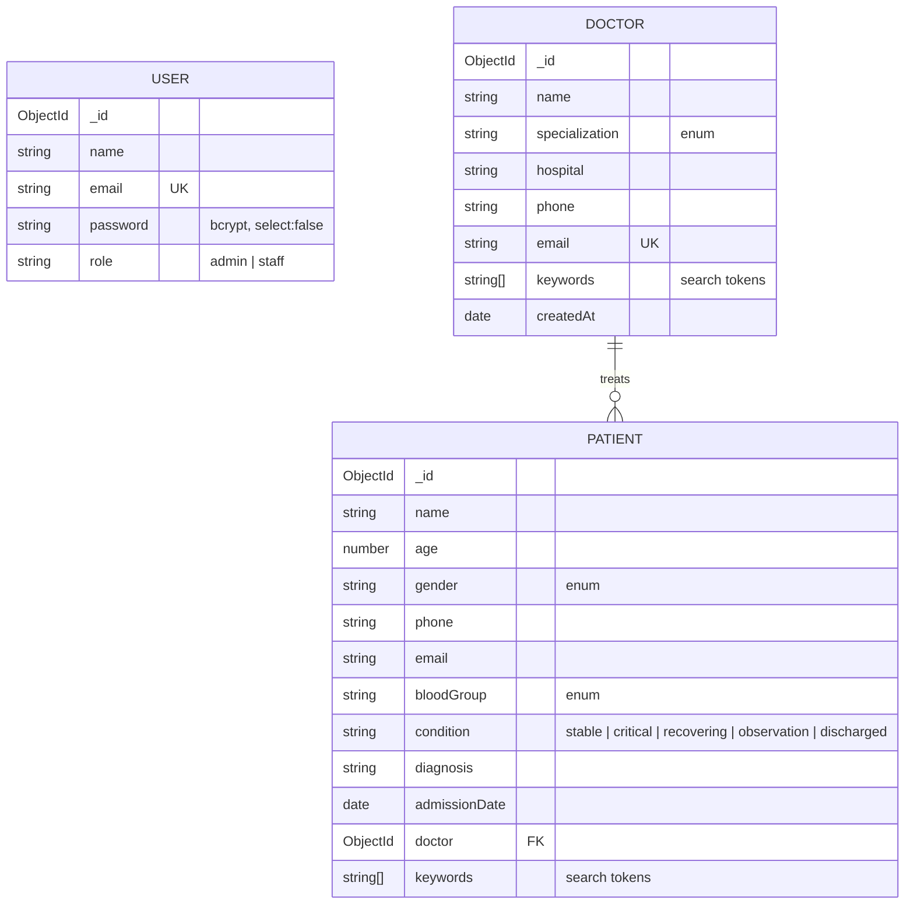

Patients reference doctors (rather than being embedded) because a doctor can have an unbounded number of patients, patients are queried independently on their own page, and a patient can be reassigned to another doctor.

---

## Technical decisions

### 1. Index-backed prefix search with a `keywords` array instead of `$regex` "contains" or `$text`

**Problem.** Search has to feel instant and match partial input. Typing `smi` should find *John Smith*, and `card` should find every cardiologist. MongoDB's usual options both fall short:

| Option | Partial matches? | Uses an index? | Verdict |
| --- | --- | --- | --- |
| `{ name: /smi/i }` (contains, case-insensitive) | ✅ | ❌ full collection scan | Slows down linearly with data size |
| `$text` index | ❌ whole words only (`smi` ≠ `smith`), stemming surprises | ✅ | Bad search-as-you-type UX |
| Atlas Search | ✅ | ✅ | Requires Atlas and adds infrastructure; overkill here |
| **`keywords` array + anchored regex** | ✅ word-prefix | ✅ index range scan | **Chosen** |

**How it works** (`server/src/utils/search.ts`):

- On every write, the service builds `keywords`: the lower-cased words of the searchable fields plus a digits-only phone number. For a doctor that's name, specialization, hospital, email and phone. For a patient it's name, email, phone and diagnosis. `"Dr. Cristina Batz", "Cardiology"` becomes `["dr", "cristina", "batz", "cardiology", …]`.
- A multikey index `{ keywords: 1 }` covers the array.
- The query lower-cases the input, splits it into words, and requires each word to prefix-match some keyword: `{ $and: [{ keywords: /^john/ }, { keywords: /^card/ }] }`. A **case-sensitive, left-anchored** regex is the one regex form MongoDB can answer with an index range scan (`["john", "joho")`). That's why the tokens are stored pre-lower-cased rather than queried with the `i` flag.
- Input is regex-escaped, and the API caps it at 5 terms and 100 characters.

**Result.** Search never scans the collection. The query planner picks whichever index reads less: `keywords_1` (only documents whose words start with the term), or the sort index with the keyword test applied while walking it. On 100,000 patients, a page of search results reads a few hundred documents and takes 2–4 ms. Multi-word queries narrow the results naturally (`john card`), and phone fragments like `555` work too.

**Trade-offs.** The array costs a little extra storage, and writes must keep it in sync (handled in one place in each service). It matches word *prefixes*, not mid-word substrings, which suits how people search for names. If fuzzy or typo-tolerant search becomes a requirement, the next step is Atlas Search or Elasticsearch behind the same `search` query parameter.

### 2. TanStack Query for server state + the URL for filter state, instead of Redux or React Context

**Problem.** Almost all of this app's state is *server* state: paginated lists, counts and aggregates that live in MongoDB and change underneath you. The rest is *filter* state (search, page, sort, date ranges) that users expect to survive a refresh and work with the back button.

**Why not Redux or Context?**

- Redux (even with RTK) would mean hand-writing loading flags, error states, caching, cache invalidation, request de-duplication and cancellation. RTK Query solves that but brings a global store this app doesn't otherwise need.
- A Context holding filters or data re-renders *every* consumer whenever *any* value changes. That's the opposite of the "avoid unnecessary re-renders" requirement, and it still doesn't cache anything.

**What we do instead**

- **TanStack Query owns server state.** Hierarchical query keys (`['doctors', 'list', params]`, `['doctors', 'detail', id, 'patients', params]`) let a mutation call `invalidateQueries(['doctors'])` and refresh every affected view, including dashboard stats. `placeholderData: keepPreviousData` keeps the current page on screen while the next loads, so there's no layout jump. Each request gets an `AbortSignal`, so fast typing cancels stale requests. Retries are disabled for 4xx errors.
- **The URL owns filter state** (`useUrlFilters` hook). `?search=card&specialization=Cardiology&page=2` is the single source of truth. Views are shareable and bookmarkable, back/forward work, and a refresh restores the exact view with no extra state library. Defaults are omitted from the URL, and changing any filter resets `page`.
- **Local `useState`** is enough for what's left (open dialogs, the row being edited).

**Re-render discipline that falls out of this:** the search box keeps keystrokes in local state and pushes a debounced value (350 ms) to the URL. List rows, the table, pagination and every chart are `memo`ized and receive stable props (memoized params, `useCallback` handlers). Recharts only loads on the dashboard route, so other routes don't pay for it (dashboard first load ≈ 266 kB vs ≈ 180 kB elsewhere).

### Other decisions in brief

- **Same-origin proxy and `httpOnly` cookie, not `localStorage` tokens.** JavaScript can never read the token, which removes the XSS token-theft vector. `SameSite=Lax` plus a JSON-only API mitigates CSRF. The browser never makes a cross-origin call.
- **Patient counts via aggregation, not a denormalized counter.** The doctor list counts patients for *only the 10–50 doctors on the page* with a single `$match: { doctor: { $in: ids } } → $group` query, served by the `{ doctor: 1, … }` compound indexes. That's always correct, with no counter drift and no transactions needed.
- **Blocking doctor deletion while patients exist** (HTTP 409) instead of a silent cascade. Deleting medical records should be a deliberate act.
- **Zod at both edges.** The same rules run in the browser (instant feedback) and the API (the actual security boundary). Server-side Zod also strips unknown keys, which blocks NoSQL operator injection such as `?search[$gt]=`.

---

## Performance & optimization

### Indexes

Indexes follow the **ESR rule** (Equality → Sort → Range). Every sort ends in a unique `_id` tiebreaker, so pages never overlap when values collide. Every index that serves a sort ends with that same key, so MongoDB reads the page straight off the index and stops after `limit` rows instead of sorting every match in memory.

| Collection | Index | Serves |
| --- | --- | --- |
| doctors | `{ email: 1 }` unique | uniqueness, lookups |
| doctors | `{ createdAt: -1, _id: -1 }` | default sort + "joined" date range |
| doctors | `{ specialization: 1, createdAt: -1, _id: -1 }` | specialization filter + sort |
| doctors | `{ hospital: 1, createdAt: -1, _id: -1 }` | hospital filter + sort, `distinct('hospital')` |
| doctors | `{ name: 1, _id: 1 }` | A–Z / Z–A sort, filter dropdown |
| doctors | `{ keywords: 1 }` | search |
| patients | `{ createdAt: -1, _id: -1 }` | default sort: most recently added first |
| patients | `{ doctor: 1, createdAt: -1, _id: -1 }` | a doctor's patient list |
| patients | `{ condition: 1, createdAt: -1, _id: -1 }` | condition filter + default sort |
| patients | `{ admissionDate: -1, _id: -1 }` | "Recently admitted" sort, admission date range, admissions timeline |
| patients | `{ doctor: 1, admissionDate: -1, _id: -1 }` | patients-per-doctor aggregations, admission sort per doctor |
| patients | `{ condition: 1, admissionDate: -1, _id: -1 }` | condition filter + admission sort, condition breakdown |
| patients | `{ gender: 1, admissionDate: -1 }` | gender filter |
| patients | `{ name: 1, _id: 1 }` | A–Z sort |
| patients | `{ age: 1, _id: 1 }` | age sort (both directions), age-group filter |
| patients | `{ keywords: 1 }` | search |
| users | `{ email: 1 }` unique | login |

**Verified with the MongoDB profiler on 100,000 patients.** All 30 list-query combinations of search, filters, sorts and pages are served by an index, and list counts trigger zero collection scans. Before tuning, some combinations read far more records than needed:

| Query | Records read before → after |
| --- | --- |
| Sort patients by name | 100,000 (in-memory sort) → **10** |
| A doctor's patient list | 342 (in-memory sort) → **10** |
| Condition filter | 122 → **10** |
| Search + condition | 1,212 (in-memory sort) → 607 |
| Unfiltered list total | full collection scan → **O(1) metadata** |

One known trade-off: an admission-date range combined with the default "recently added" sort filters on one field and sorts on another, so it sorts its matches in memory. That is about 8,000 rows and 25 ms for a two-week range at 100k patients. Picking "Recently admitted" makes it fully index-served.

### Query patterns

- **`lean()`** on every read: plain objects, no Mongoose document hydration.
- **Page and count in parallel** (`Promise.all([find().skip().limit(), count])`). With no filter the count uses `estimatedDocumentCount()` (O(1)). With a filter it uses an index-backed `countDocuments`.
- **Selective `populate`.** One batched `$in` lookup per page, fetching only `name specialization hospital`.
- **Dashboard.** Fourteen independent queries run concurrently. Totals use `estimatedDocumentCount()` (metadata, O(1)). Aggregations `$group` on indexed fields *before* any `$lookup`, so joins touch at most a handful of grouped rows. Time series use `$dateTrunc` in the **viewer's timezone**, and the server fills empty buckets so charts have no gaps. Results are cached for 30 s per range and timezone, and the cache is invalidated on every write.
- `autoIndex` is disabled in production. `npm --prefix server run db:indexes` is the migration step: it builds missing indexes and drops ones no longer declared. The seed script runs it too.

### Frontend

- Debounced search, cancelled in-flight requests, `keepPreviousData` paging, and `memo`/`useCallback`/`useMemo` on hot paths. Re-renders were measured with a React commit hook:

  | Action | What re-renders |
  | --- | --- |
  | Typing 5 characters in search | only the search box; table **0×** until the debounce fires, then once |
  | Opening and closing the edit dialog | table and rows **0×** |
  | Typing in a form | form once (dirty flag), not per keystroke (uncontrolled inputs) |
  | Dashboard range switch | each chart and each KPI card **once** |
- Route-level code splitting, plus `optimizePackageImports` for `lucide-react`, `recharts` and `date-fns`.
- Skeletons sized like the real content, so there's no layout shift.
- The theme is applied by an inline script before first paint, so there's no light/dark flash.

---

## API reference

All routes are prefixed with `/api`. Everything except `/auth/login`, `/auth/logout` and `/health` requires authentication.

| Method | Route | Role | Description |
| --- | --- | --- | --- |
| `POST` | `/auth/login` | public | Sign in. Sets the `dt_token` cookie. Rate-limited (10 failed attempts per 15 min). |
| `POST` | `/auth/logout` | public | Clears the cookie |
| `GET` | `/auth/me` | any | Current user |
| `GET` | `/doctors` | any | List. Query: `page, limit, search, specialization, hospital, from, to, sort` |
| `GET` | `/doctors/options` | any | Lightweight doctor / hospital / specialization lists for dropdowns |
| `POST` | `/doctors` | any | Create a doctor |
| `GET` | `/doctors/:id` | any | Doctor + patient count + condition breakdown |
| `PATCH` | `/doctors/:id` | any | Update a doctor |
| `DELETE` | `/doctors/:id` | admin | Delete (409 if the doctor still has patients) |
| `GET` | `/doctors/:id/patients` | any | The doctor's patients (same query parameters as `/patients`) |
| `POST` | `/doctors/:id/patients` | any | Add a patient under the doctor |
| `DELETE` | `/doctors/:id/patients/:patientId` | admin | Remove a patient from the doctor's list |
| `GET` | `/patients` | any | List. Query: `page, limit, search, condition, gender, doctor, ageMin, ageMax, from, to, sort` |
| `POST` | `/patients` | any | Create a patient (body includes `doctor`) |
| `GET` | `/patients/:id` | any | Single patient |
| `PATCH` | `/patients/:id` | any | Partial update. Empty optional fields are removed. |
| `DELETE` | `/patients/:id` | admin | Delete |
| `GET` | `/stats/overview` | any | Dashboard aggregates. Query: `range=7d\|30d\|90d\|12m`, `tz=<IANA zone>` |
| `GET` | `/health` | public | Liveness + DB status |

**List response**

```json
{
  "success": true,
  "data": [ { "_id": "…", "name": "Dr. Jenna Howe", "patientCount": 13, "…": "…" } ],
  "meta": { "page": 1, "limit": 10, "total": 60, "totalPages": 6, "hasNextPage": true, "hasPrevPage": false }
}
```

**Error response** (400 / 401 / 403 / 404 / 409 / 413 / 500; stack traces are never sent in production)

```json
{ "success": false, "message": "Validation failed", "errors": { "email": ["Enter a valid email"] } }
```

---

## Project structure

```
doctor-tracker/
├── docker-compose.yml           # MongoDB 7
├── package.json                 # convenience scripts for both apps
├── client/docs/screenshots/
├── server/                      # Express REST API
│   ├── .env.example
│   └── src/
│       ├── index.ts             # bootstrap + graceful shutdown
│       ├── app.ts               # middleware pipeline + route mounting
│       ├── config/              # env (Zod-validated), db
│       ├── middleware/          # auth, validate, error
│       ├── models/              # User, Doctor, Patient (+ indexes)
│       ├── modules/             # feature modules: routes → schema → service
│       │   ├── auth/
│       │   ├── doctors/
│       │   ├── patients/
│       │   └── stats/
│       ├── utils/               # ApiError, asyncHandler, search, pagination, cache, schemas
│       └── scripts/             # seed.ts, sync-indexes.ts (index migration)
└── client/                      # Next.js app
    ├── .env.example
    ├── vercel.json              # Vercel function region (sin1)
    └── src/
        ├── middleware.ts        # route guard
        ├── app/api/[...path]/   # same-origin proxy to the API
        ├── app/
        │   ├── login/
        │   ├── not-found.tsx    # branded 404
        │   └── (app)/           # authenticated layout (AppShell) + error.tsx boundary
        │       ├── dashboard/
        │       ├── doctors/[id]/
        │       └── patients/
        ├── components/
        │   ├── ui/              # Button, Field/Input/Select, Modal, ConfirmDialog, Pagination, Card…
        │   ├── layout/          # AppShell, PageHeader, ThemeToggle
        │   ├── shared/          # SearchInput, FilterPanel, ConditionBadge
        │   ├── dashboard/       # StatCard, charts
        │   ├── doctors/         # DoctorFormModal
        │   └── patients/        # PatientFormModal, PatientTable
        ├── hooks/               # use-auth, use-doctors, use-patients, use-stats, use-url-filters, use-debounce, use-reduced-motion
        └── lib/                 # api client, types, query keys, utils
```

---

## Visual evidence

### Desktop

| Dashboard (light) | Dashboard (dark) |
| --- | --- |
|  |  |

| Doctors (search + filters) | Doctor detail & patients |
| --- | --- |
| 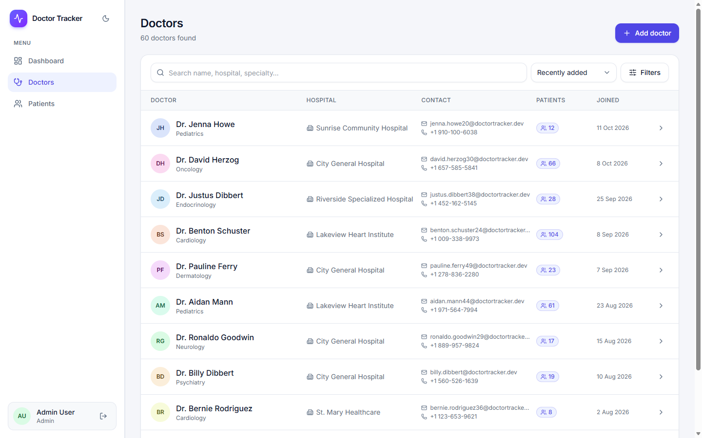 | 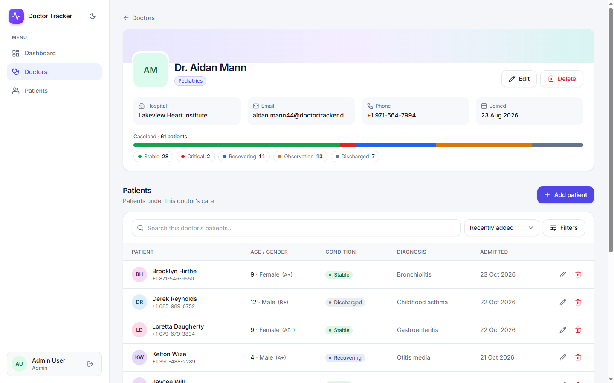 |

| Patients | Add patient |
| --- | --- |
| 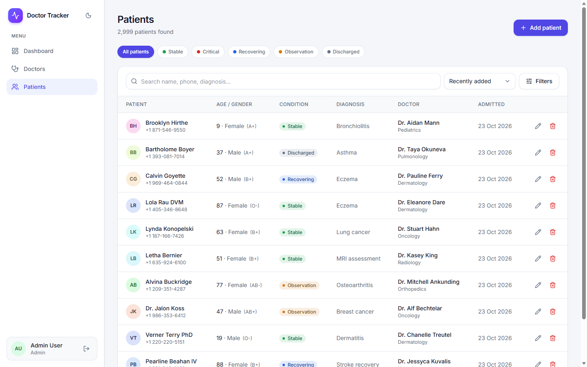 | 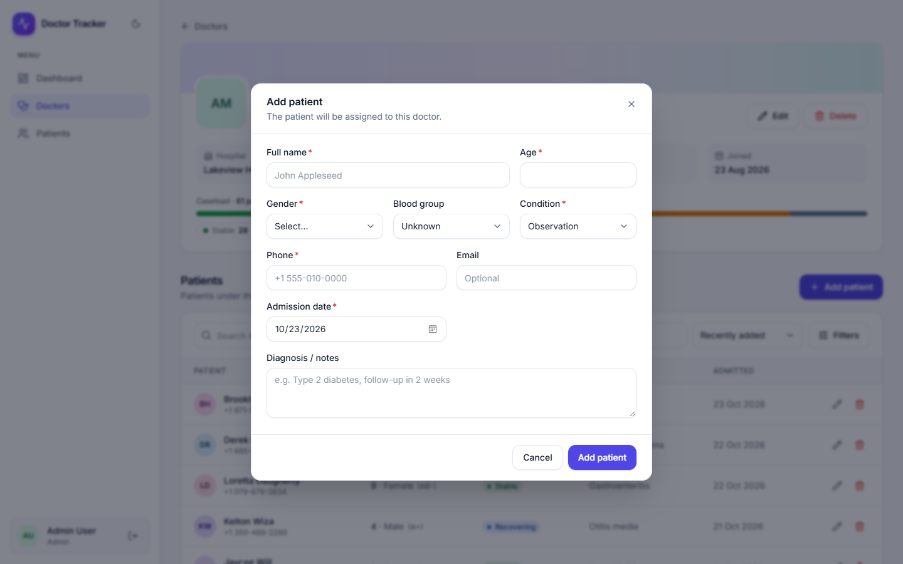 |

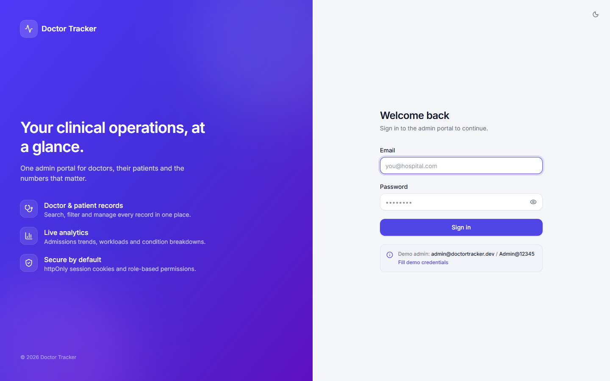

### Mobile

| Login | Dashboard | Doctors | Patients | Navigation |
| --- | --- | --- | --- | --- |
| 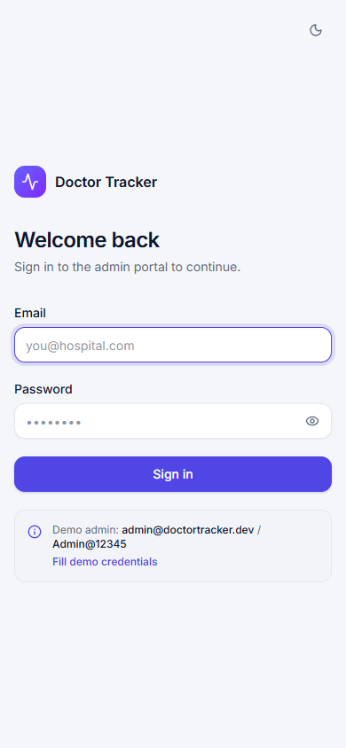 | 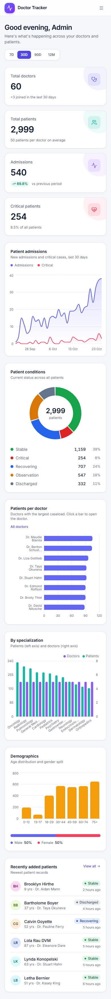 | 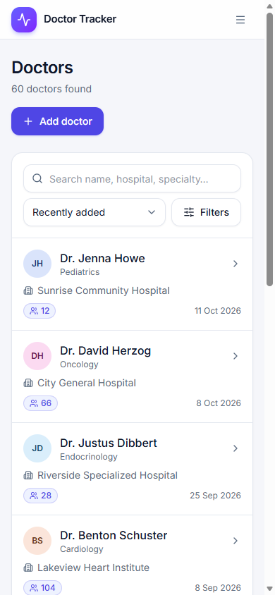 | 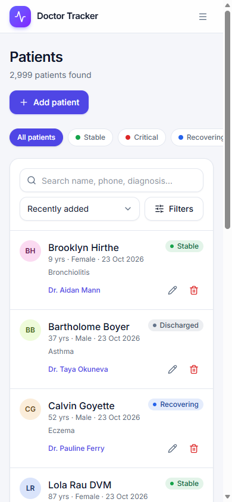 |  |

---

## Scalability considerations

- **Stateless API.** JWT sessions mean any number of API instances can sit behind a load balancer. The only in-process state is the dashboard cache (`utils/cache.ts`), whose small interface can be backed by Redis without touching callers.
- **Deep pagination.** Offset pagination (`skip`) is the right fit for page-number UX at this scale. For very large collections, the `(admissionDate, _id)` / `(createdAt, _id)` indexes already support switching to cursor (keyset) pagination.
- **Exact counts.** `countDocuments` on a filtered query is index-backed but still O(matches). At millions of rows, cap counts (for example, "10,000+") or cache them per filter.
- **Analytics at scale.** Aggregations currently run live with a 30 s cache. At high volume, move them to pre-aggregated daily rollups (a scheduled `$merge` into a `daily_stats` collection) or point them at a secondary with `readPreference: secondaryPreferred`.
- **Search.** The keyword index scales well for prefix search. Typo tolerance or relevance ranking would move to Atlas Search behind the same `search` parameter.
- **Operations.** Graceful shutdown (SIGTERM drains connections), a `/api/health` endpoint for probes, Zod-validated configuration, structured error responses, and `morgan` request logging.
- **Dependencies.** `npm audit --omit=dev` reports **0 vulnerabilities** in all three packages. Next 15's bundled PostCSS is pinned to the patched 8.5.x through an npm `overrides` entry. The one remaining dev-only advisory (`braces`, inside eslint's glob matcher) has no patched release, and it never ships to users or runs in production.
